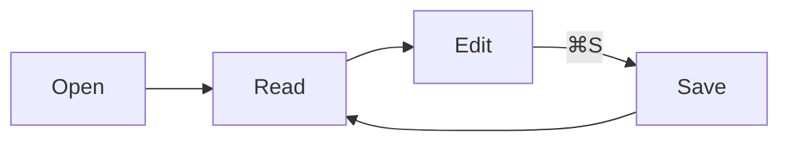
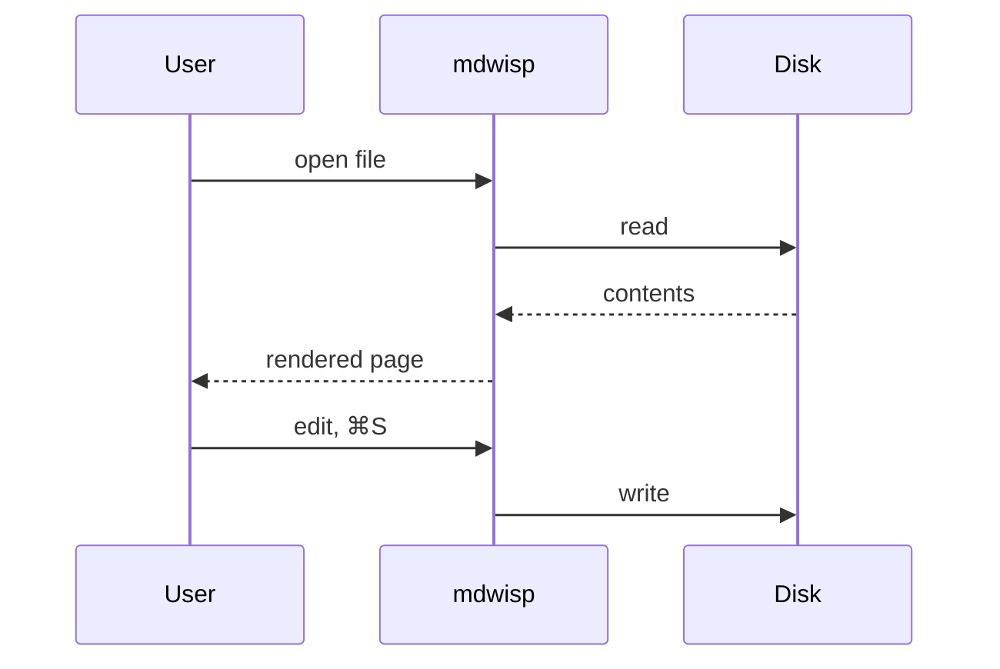
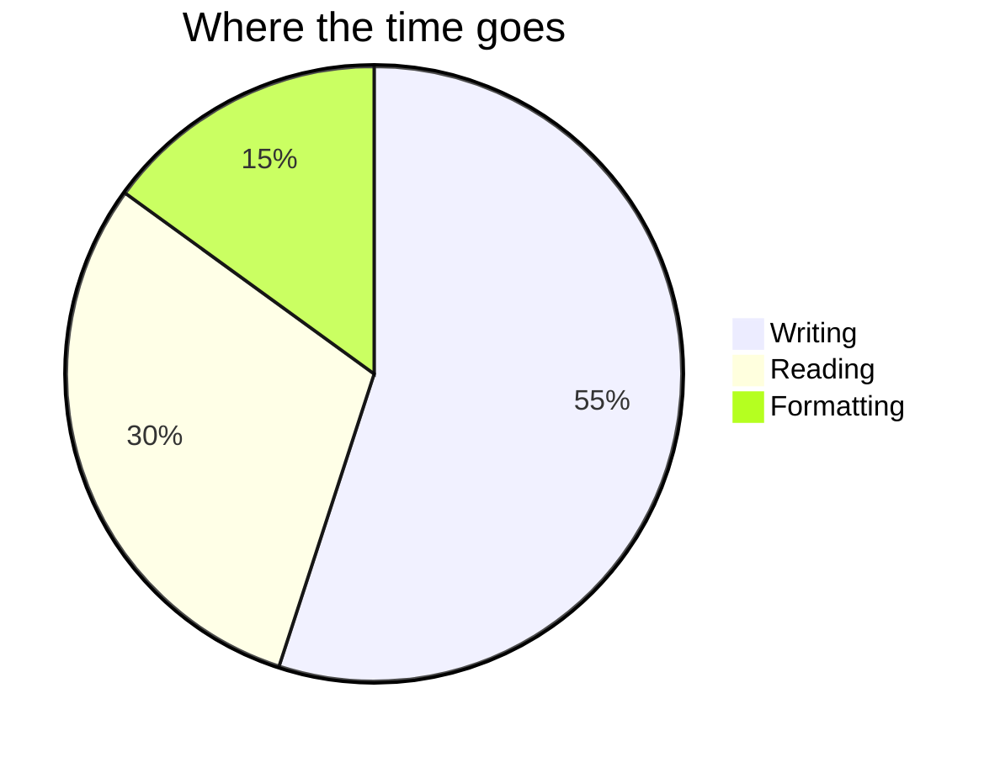

# mdwisp showcase

This document exercises everything mdwisp renders and edits. Open it in the
three views (⌘1 reading, ⌘2 editor, ⌘3 source), open the outline sidebar
(⌘⌥S), try find (⌘F), print (⌘P) and export it as a PDF (⌘⇧E). Everything
below is plain Markdown; nothing here needs a network connection.

## Text

Paragraphs wrap to the window. *Emphasis*, **strong emphasis**,
***both together***, ~~strikethrough~~ and `inline code` all render inline.
A hard line break follows this sentence.  
This line starts after the break.

Autolinks like <https://mdwisp.com> and bare URLs such as
https://github.com/gailleur/mdwisp become links. So do
[reference-style links][repo] and [inline links](https://mdwisp.com/privacy
"Privacy page"). Email: <hello@example.com>.

Escaped characters stay literal: \*not emphasis\*, \# not a heading, 1\. not
a list. Unicode and emoji render as text: café, naïve, 日本語, 🚀.

> A blockquote, which can hold **formatting**, `code` and a nested quote:
>
> > The inner quote. Quotes can also contain lists:
> >
> > - one
> > - two

---

## Headings

The six levels below feed the outline sidebar. Click one there to jump.

### Level three

#### Level four

##### Level five

###### Level six

## Lists

- An unordered list
- With a second item
  - A nested item
  - Another nested item
    - Three levels deep
- A long item: Lorem ipsum dolor sit amet, consectetur adipiscing elit, sed
  do eiusmod tempor incididunt ut labore et dolore magna aliqua, so that it
  wraps onto a second line in a normal window.

1. An ordered list
2. Numbered automatically
3. With nesting:
   1. Inner one
   2. Inner two
10. Numbers out of sequence still count on from the start

- [x] A completed task
- [x] Another completed task
- [ ] An open task
- [ ] An open task with a [link](https://mdwisp.com) and `code`

Term lists are not part of GitHub-flavoured Markdown; this paragraph just
checks that a list followed by text ends cleanly.

## Code

Inline code like `const x = 1` keeps its spacing. Fenced blocks get a
language label and a copy button in the reading view.

```typescript
export function readingTime(words: number, wpm = 238): string {
  const minutes = Math.ceil(words / wpm);
  return minutes <= 1 ? "< 1 min" : `${minutes} min`;
}
```

```python
def fib(n: int) -> int:
    """Return the n-th Fibonacci number."""
    a, b = 0, 1
    for _ in range(n):
        a, b = b, a + b
    return a
```

```rust
fn main() {
    let names = ["reading", "editor", "source"];
    for (i, name) in names.iter().enumerate() {
        println!("⌘{} → {name}", i + 1);
    }
}
```

```bash
# A shell block with a long line that should scroll horizontally rather than wrap: tar -czf archive.tar.gz --exclude='*.tmp' --exclude='node_modules' ./project
sha256sum -c SHA256SUMS
```

```
A block with no language.
    Indentation is preserved.
```

    An indented code block, four spaces in.

## Tables

| Feature        | Reading | Editor | Source | Notes                         |
|----------------|:-------:|:------:|:------:|-------------------------------|
| Headings       |   yes   |  yes   |  yes   | outline follows all three     |
| Tables         |   yes   |  yes   |  yes   | alignment markers respected   |
| Task lists     |   yes   |  yes   |  yes   | click to toggle in the editor |
| Maths          |   yes   |   —    |   —    | plain text while editing      |
| Mermaid        |   yes   |   —    |   —    | plain text while editing      |

| Right-aligned numbers | Left text |
|----------------------:|:----------|
|                  1200 | design    |
|                   450 | printing  |
|                    80 | shipping  |

## Images

A relative image loads from the document's folder:


A remote image stays blank until View ▸ Remote Images is turned on, and the
app never fetches it on its own:


## Maths

Inline maths such as $E = mc^2$ and $\sqrt{a^2 + b^2}$ sits in the line.
Display maths gets its own block:

$$
\int_0^\infty e^{-x^2}\,dx = \frac{\sqrt{\pi}}{2}
$$

$$
\begin{pmatrix} a & b \\ c & d \end{pmatrix} \begin{pmatrix} x \\ y \end{pmatrix} = \begin{pmatrix} ax + by \\ cx + dy \end{pmatrix}
$$

A dollar sign on its own, like $5 or $10, is not maths.

## Diagrams







## Footnotes

Footnotes[^1] are collected at the end of the document, and a second one[^long]
can hold more than a line.

## HTML

Markdown allows inline HTML. mdwisp sanitises it, so <strong>safe tags</strong>
and <kbd>Ctrl</kbd>+<kbd>S</kbd> render, while scripts, forms and event
handlers are removed:

<div align="center">A centred block via HTML.</div>

<details>
<summary>A collapsible section</summary>

Hidden content with **Markdown** inside.

</details>

<script>alert("this never runs")</script>
<a href="javascript:alert(1)">this link is neutralised</a>

## Long paragraph

Lorem ipsum dolor sit amet, consectetur adipiscing elit. Praesent sit amet
turpis a nunc bibendum pretium. Vestibulum ante ipsum primis in faucibus orci
luctus et ultrices posuere cubilia curae; Integer at libero nec ligula
fermentum pellentesque. Nullam a purus vel massa porta porttitor. Donec
dignissim, sapien non pharetra ultricies, justo lorem tincidunt sem, et
pharetra elit lorem a nisl. Fusce efficitur, risus at sagittis dapibus, arcu
ipsum facilisis nulla, vitae iaculis velit ligula nec nisi. This paragraph
exists so the word count, reading time and page breaks in print have
something to work with.

---

*Last line: a horizontal rule above, emphasis here, and the footnotes below.*

[repo]: https://github.com/gailleur/mdwisp "mdwisp on GitHub"

[^1]: The first footnote.
[^long]: A longer footnote with `code`, a [link](https://mdwisp.com) and
    a second paragraph.

    Which continues here.
